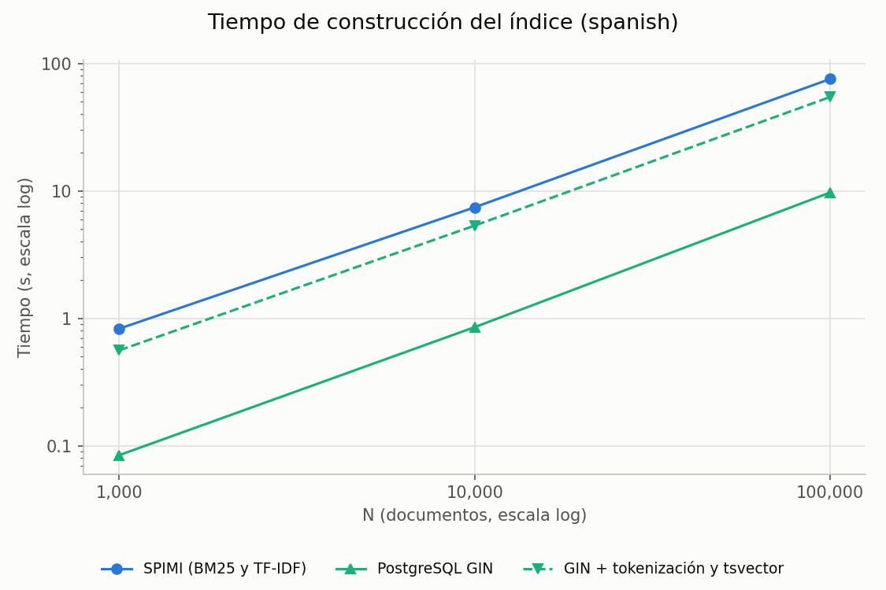
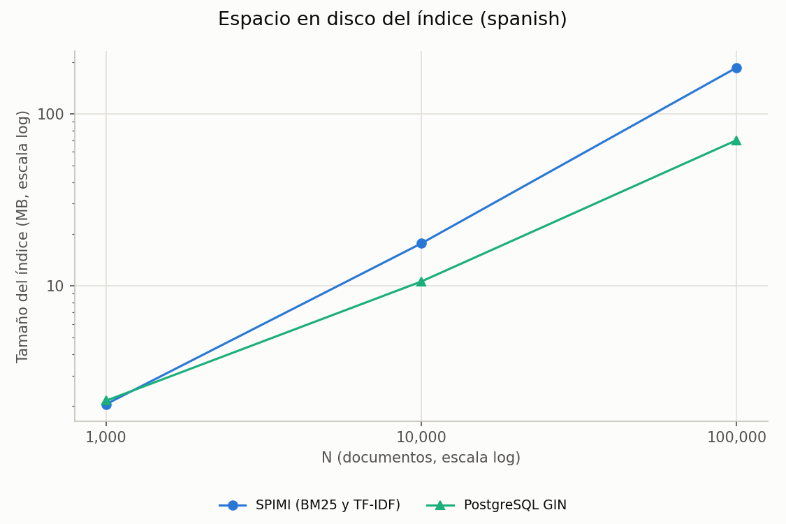
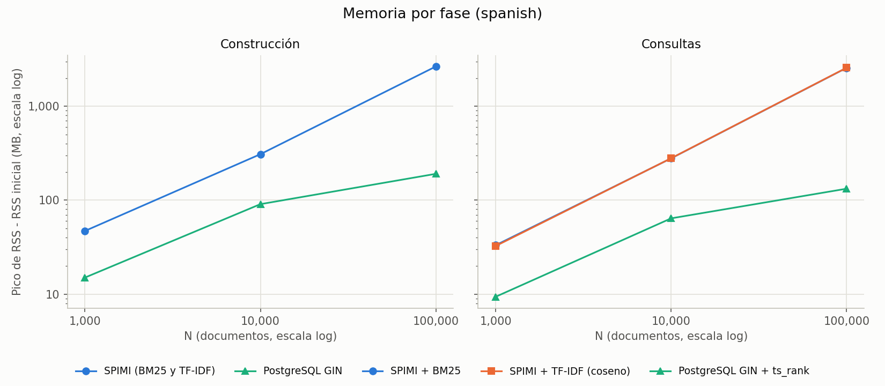
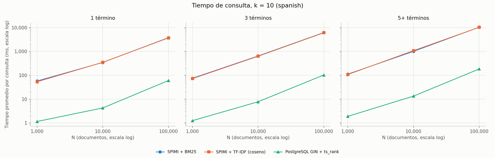

# Resumen: búsqueda full-text con SPIMI y PostgreSQL GIN

Compara tres técnicas sobre los mismos documentos, consultas y k:

- **SPIMI + BM25** y **SPIMI + TF-IDF (coseno)**, del DBMS propio. Comparten el mismo índice.
- **PostgreSQL GIN + `ts_rank`**. GIN resuelve el filtro `@@`; `ts_rank` ordena los candidatos.

Instalación, comandos y metodología completa: [`benchmarks/README.md`](../README.md#comparación-de-texto-spimi-vs-postgresql-gin). Datos por consulta: [`text_comparison_results.csv`](text_comparison_results.csv). Entorno: [`text_comparison_environment.json`](text_comparison_environment.json).

## 1. Conclusiones

- **Velocidad:** GIN + `ts_rank` fue más rápido en todos los casos: entre 50 y 83 veces frente a SPIMI + BM25. Esta diferencia no se debe solo al índice: SPIMI corre sobre un motor SQL en Python y PostgreSQL es un motor maduro en C.
- **Espacio y memoria con N = 100,000:** el índice SPIMI ocupa 2.6 veces más que GIN (185 MB frente a 70 MB). En consultas, SPIMI usa 19 veces más memoria (2.6 GB frente a 133 MB).
- **Construcción:** el índice GIN se construye unas 8 veces más rápido. Si se le suma la tokenización y el `tsvector`, que SPIMI hace dentro de su tiempo, la ventaja baja a unas 1.4 veces.
- **Relevancia:** con N = 100,000, BM25 y `ts_rank` obtienen resultados parecidos y TF-IDF cae con fuerza. Estos valores miden si un documento contiene todos los términos, no si es realmente útil (sección 5).

## 2. Configuración

| Parámetro | Valor |
|---|---|
| Corpus | `spanish` (noticias), semilla 42 |
| N | 1,000 / 10,000 / 100,000 documentos |
| Consultas | 10 por grupo (1, 3 y 5+ términos), semilla 43, candidatos con semántica OR |
| k | 10 |
| Ejecuciones por consulta | 1 de calentamiento (descartada) y 5 medidas |
| PostgreSQL | 16.4 en Docker (2 CPU, 4 GB), `shared_buffers` 128 MB, sin paralelismo ni JIT |
| DBMS propio | Python 3.12.10, páginas de 4 KB, buffer pool de 64 páginas |
| Máquina | Windows 11, 12 CPU lógicas, 15.7 GB de RAM |

`hnswlib` no se pudo instalar en esta máquina porque requiere compilador de C++. Se usó `chroma-hnswlib` 0.7.5, que no interviene en la búsqueda de texto.

`compare_text_results.py` confirmó que los tres motores usan el mismo k, los mismos relevantes, los mismos candidatos y el mismo vocabulario.

## 3. Construcción, espacio y memoria

1 MB = 1,048,576 B. BM25 y TF-IDF comparten índice, así que comparten construcción, tamaño y memoria de construcción. La memoria es el pico de RSS menos el RSS inicial de cada fase.

| N | Motor | Construcción (s) | Con tokenización y `tsvector` (s) | Índice (MB) | Vocabulario | Memoria de construcción (MB) | Memoria de consulta (MB) |
|---|---|---:|---:|---:|---:|---:|---:|
| 1,000 | SPIMI + BM25 | 0.828 | — | 2.05 | 23,771 | 47.1 | 33.2 |
| 1,000 | SPIMI + TF-IDF | 0.828 | — | 2.05 | 23,771 | 47.1 | 32.6 |
| 1,000 | GIN + `ts_rank` | 0.084 | 0.561 | 2.15 | 23,771 | 15.0 | 9.4 |
| 10,000 | SPIMI + BM25 | 7.429 | — | 17.63 | 67,221 | 309.1 | 279.2 |
| 10,000 | SPIMI + TF-IDF | 7.429 | — | 17.63 | 67,221 | 309.1 | 280.0 |
| 10,000 | GIN + `ts_rank` | 0.853 | 5.341 | 10.59 | 67,221 | 90.8 | 64.1 |
| 100,000 | SPIMI + BM25 | 75.506 | — | 185.14 | 139,575 | 2,655.1 | 2,566.6 |
| 100,000 | SPIMI + TF-IDF | 75.506 | — | 185.14 | 139,575 | 2,655.1 | 2,574.5 |
| 100,000 | GIN + `ts_rank` | 9.717 | 54.529 | 70.14 | 139,575 | 191.0 | 132.6 |

## 4. Tiempo de consulta

Tiempo promedio en el cliente por consulta, en milisegundos.

| N | Términos | SPIMI + BM25 | SPIMI + TF-IDF | GIN + `ts_rank` |
|---|---|---:|---:|---:|
| 1,000 | 1 | 57.334 | 53.234 | 1.155 |
| 1,000 | 3 | 74.972 | 72.243 | 1.251 |
| 1,000 | 5+ | 111.471 | 107.134 | 1.891 |
| 10,000 | 1 | 344.656 | 348.632 | 4.262 |
| 10,000 | 3 | 642.733 | 626.004 | 7.757 |
| 10,000 | 5+ | 1,003.628 | 1,076.601 | 13.355 |
| 100,000 | 1 | 3,769.454 | 3,680.547 | 60.205 |
| 100,000 | 3 | 6,173.418 | 6,055.919 | 102.763 |
| 100,000 | 5+ | 10,332.268 | 10,252.679 | 183.321 |

### Uso del índice GIN

Consultas de cada grupo en las que el plan de PostgreSQL usó GIN. Cuando no lo usó, el planificador eligió otro plan. SPIMI usó su índice en todas las consultas.

| N | 1 término | 3 términos | 5+ términos |
|---|---:|---:|---:|
| 1,000 | 4/10 | 1/10 | 0/10 |
| 10,000 | 10/10 | 9/10 | 2/10 |
| 100,000 | 10/10 | 10/10 | 8/10 |

Por eso estos tiempos corresponden a "PostgreSQL con el plan que eligió", no siempre a GIN.

## 5. Precision@10 y Recall@10

**Etiquetas de relevancia:** no hay juicios humanos. Un documento es relevante si contiene **todos** los términos de la consulta. Las etiquetas están congeladas en `benchmarks/workload/text_qrels_spanish.tsv`.

| N | Términos | BM25 P@10 | BM25 R@10 | TF-IDF P@10 | TF-IDF R@10 | `ts_rank` P@10 | `ts_rank` R@10 |
|---|---|---:|---:|---:|---:|---:|---:|
| 1,000 | 1 | 0.97 | 0.258 | 0.97 | 0.258 | 0.97 | 0.258 |
| 1,000 | 3 | 0.38 | 0.735 | 0.34 | 0.682 | 0.38 | 0.735 |
| 1,000 | 5+ | 0.19 | 0.912 | 0.19 | 0.912 | 0.19 | 0.912 |
| 10,000 | 1 | 1.00 | 0.031 | 1.00 | 0.031 | 1.00 | 0.031 |
| 10,000 | 3 | 0.42 | 0.645 | 0.28 | 0.518 | 0.45 | 0.655 |
| 10,000 | 5+ | 0.19 | 0.902 | 0.19 | 0.902 | 0.19 | 0.902 |
| 100,000 | 1 | 1.00 | 0.003 | 1.00 | 0.003 | 1.00 | 0.003 |
| 100,000 | 3 | 0.58 | 0.591 | 0.05 | 0.111 | 0.72 | 0.607 |
| 100,000 | 5+ | 0.46 | 0.901 | 0.23 | 0.351 | 0.46 | 0.901 |

Cómo interpretar estos valores:

- **Esta etiqueta no mide utilidad real:** favorece a los rankings que premian contener todos los términos.
- **Con 1 término casi no distingue rankings:** todo candidato es relevante. P@10 es 1.00 salvo cuando hay menos de 10 relevantes, y R@10 es bajo porque solo se devuelven 10 entre muchos relevantes.
- **Con 5+ términos, P@10 tiene un techo bajo:** en 9 de 10 consultas hay solo 1 relevante con N = 1,000 y 10,000, y 4 con N = 100,000. Por eso P@10 no puede superar 0.1 o 0.4 en esas consultas. La subida de 0.19 a 0.46 viene de ese techo, no de una mejora del ranking.
- **La caída de TF-IDF responde a la fórmula:** el coseno usa la frecuencia sin suavizar y favorece a los documentos que repiten mucho un solo término. En G3-01, con N = 100,000, el primero repite 12 veces un término y no contiene los otros dos (coseno 0.316); el mejor documento con los tres queda en la posición 216 (coseno 0.067). Se recalculó el coseno por separado en 4 consultas y el top 10 coincidió exactamente con el del motor.

## 6. Ventajas y desventajas

El índice y la función de ranking son piezas distintas: el índice encuentra los candidatos y el ranking los ordena. GIN no calcula `ts_rank`, y BM25 y TF-IDF usan el mismo índice SPIMI.

### Índices

| Índice | Función | Ventajas | Desventajas |
|---|---|---|---|
| **SPIMI** | Índice invertido del DBMS propio; encuentra los candidatos de `MATCH` | Integrado en el motor y sin servidor externo. Se usó en todas las consultas. Sirve a BM25 y TF-IDF con un solo índice | Más lento de construir que GIN (7.8 veces con N = 100,000). Índice 2.6 veces más grande. Se carga completo en memoria al consultar |
| **GIN** | Índice invertido de PostgreSQL; resuelve el filtro `tsv @@ q` | Construcción rápida. Índice más pequeño desde N = 10,000. Bajo consumo de memoria | No ordena resultados. El planificador puede no usarlo, sobre todo con N pequeño o consultas largas. Requiere un servidor externo |

### Funciones de ranking

| Ranking | Función | Ventajas | Desventajas |
|---|---|---|---|
| **BM25** | Suma por término con IDF, frecuencia saturada y normalización por longitud | P@10 cercana o igual a `ts_rank` en casi todos los grupos. La frecuencia saturada limita el efecto de repetir un término | Requiere calibrar `k1` y `b`. Aquí se calcula en Python |
| **TF-IDF (coseno)** | Similitud coseno con frecuencia sin suavizar e IDF | Fórmula simple y clásica. Tiempo similar al de BM25 | P@10 baja hasta 0.05 con esta etiqueta y N = 100,000. Favorece repetir un solo término |
| **`ts_rank`** | Función de PostgreSQL; se calcula sobre el `tsvector` de cada candidato. Normalización 1 (1 + log de la longitud) | Mejor P@10 con 3 términos desde N = 10,000. Incluida en PostgreSQL | No usa IDF del corpus. `tsvector` guarda como máximo 256 posiciones por término |

## 7. Limitaciones

- **Corpus con repetidos:** se usan 58,424 documentos y se repiten cíclicamente hasta N. Con N = 100,000 hay solo 43,470 textos distintos, así que muchos relevantes son copias entre sí y ocupan varias posiciones del top 10.
- **Motores distintos:** los tiempos comparan el sistema completo, no solo el índice o el ranking. En SPIMI incluyen el motor SQL en Python; en PostgreSQL incluyen la red local.
- **Recursos distintos:** PostgreSQL corre en Docker con 2 CPU y 4 GB, y el DBMS propio corre directamente en Windows. La memoria usa `VmHWM` en un caso y `peak_wset` en el otro. El buffer pool del DBMS propio es de 256 KB y `shared_buffers` de 128 MB; no se midió cuánto influye.
- **Carga del DBMS propio:** el benchmark no usa el `HeapFile` normal para cargar documentos. Ese `insert` recorre todas las páginas cada vez que se llena una, y la carga con N = 100,000 tardaría días según lo extrapolado. `BulkLoadHeap` solo considera la última página durante la carga, que no se cronometra; la construcción y las consultas usan el `HeapFile` normal. Los tiempos de N = 1,000 y 10,000 con ambos métodos fueron casi iguales. El problema de `HeapFile.insert` sigue en el motor.
- **Una sola máquina:** todas las mediciones se hicieron en la misma laptop y los resultados pueden variar en otro equipo.