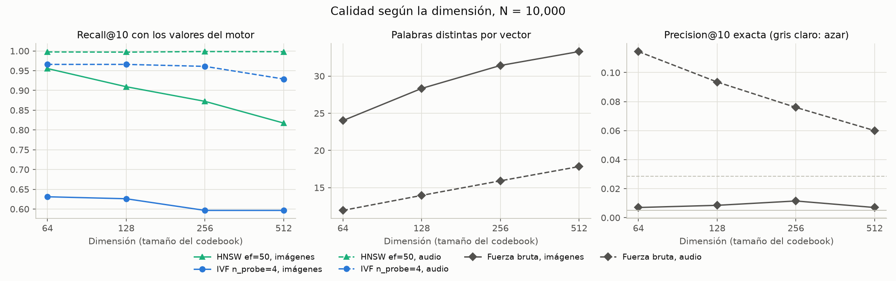
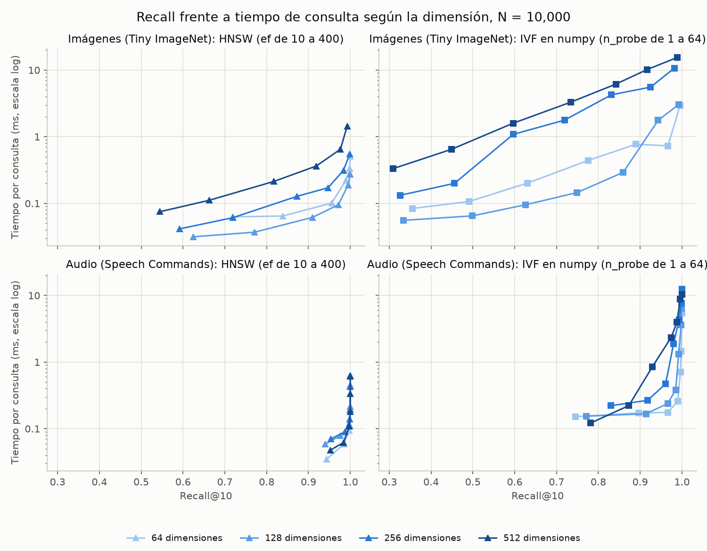
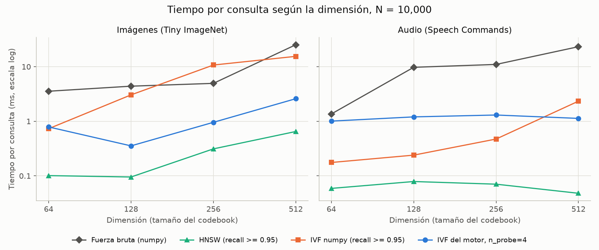
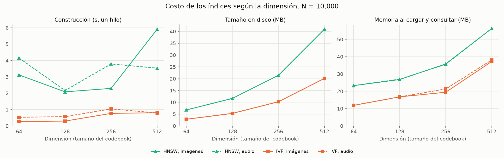

# Resumen: IVF y HNSW con dimensiones mayores a 64

Complementa la comparación de [`vector_summary.md`](vector_summary.md) (#85), que fija la dimensión en 64. Aquí se cambia el tamaño del codebook (64, 128, 256 y 512 palabras) y se mide qué pasa con los índices:

- **Mismos datos en todas las dimensiones:** los mismos 10,000 objetos y las mismas 200 consultas de Tiny ImageNet y de Speech Commands. Solo cambia el codebook que convierte los descriptores SIFT o MFCC en un histograma.
- **Métrica:** coseno sobre vectores normalizados, que es lo que usa el motor. La comparación entre métricas ya está en #85.
- **Índices:** `HNSWIndex` con un barrido de `ef`, el IVF del motor (`IVFIndex`, en Python) con `n_probe=4`, y las mismas listas de IVF con distancias en numpy (`ivf_numpy`) con un barrido de `n_probe`.

Comandos y metodología: [`benchmarks/README.md`](../README.md#ivf-y-hnsw-según-la-dimensión). Datos: [`vector_dims_results.csv`](vector_dims_results.csv). Entorno: [`vector_dims_environment.json`](vector_dims_environment.json).

## 1. Conclusiones

- **Guardado y carga funcionan en todas las dimensiones.** Los 16 índices medidos (IVF y HNSW, cuatro dimensiones, dos modalidades) devuelven exactamente los mismos vecinos y distancias después de guardarse y cargarse. Guardar tarda como máximo 0.23 s y cargar 0.17 s.
- **En imágenes, el recall con los valores del motor baja al subir la dimensión.** HNSW con `ef=50` pasa de 0.956 con 64 dimensiones a 0.818 con 512, y para volver a 0.95 hace falta `ef=200` (0.976). IVF con `n_probe=4` baja de 0.631 a 0.597. En audio casi no cambia: HNSW queda en 0.997 o más, e IVF baja de 0.966 a 0.929.
- **Más dimensiones no dan mejores resultados con estos datos.** En audio, la Precision@10 de la búsqueda exacta baja de 11.5% con 64 dimensiones a 6.0% con 512. En imágenes queda cerca del azar en todas las dimensiones: entre 0.7% y 1.2%, frente al 0.5% de elegir al azar entre 200 clases. La causa es que cada objeto tiene pocos descriptores, así que con un codebook más grande esos mismos descriptores se reparten entre más palabras: los vectores de imagen pasan de 24 a 33 palabras distintas de 64 a 512, y los de audio de 12 a 18. Dos objetos parecidos comparten menos palabras y se parecen menos para el índice.
- **El costo crece con la dimensión.** De 64 a 512, el disco de HNSW pasa de 6.8 a 41 MB y el de IVF de 2.8 a 20 MB. La memoria al cargar y consultar pasa de 23 a 56 MB en HNSW y de 12 a 37 MB en IVF. HNSW ocupa unas dos veces más que IVF porque guarda cada vector dos veces: en el grafo de hnswlib y en la copia que usa para buscar con otra métrica.
- **HNSW sigue siendo mucho más rápido que la búsqueda exacta.** Con recall ≥ 0.95 es entre 23 y 480 veces más rápido en todas las dimensiones. En imágenes con 512 dimensiones tarda 0.65 ms frente a 0.10 ms con 64, porque necesita un `ef` más alto para llegar a ese recall.
- **IVF pierde su ventaja con dimensiones altas en imágenes.** Para llegar a recall 0.95 con numpy pasa de 0.73 ms con 64 dimensiones a 15.5 ms con 512, porque tiene que sondear más listas y cada comparación es más cara. Con 512 dimensiones casi no le gana a la búsqueda exacta (25 ms).

## 2. Recomendaciones

| Escenario | Recomendación | Evidencia (N = 10,000) |
|---|---|---|
| Vectores BoW de SIFT o MFCC como los del motor | **Mantener 64 dimensiones** | Con más dimensiones cuesta más disco y memoria, y la Precision@10 no mejora (en audio baja de 11.5% a 6.0%) |
| Subir la dimensión, por ejemplo con otro extractor con más descriptores por objeto | **Subir también el `ef` de HNSW** y medirlo con los datos propios | Imágenes con 512 dimensiones: `ef=50` da recall 0.818 y `ef=200` da 0.976 |
| IVF con dimensiones altas | **Sondear más listas o usar HNSW** | Imágenes con 512 dimensiones: recall 0.597 con `n_probe=4`, y 15.5 ms con numpy para llegar a 0.95, cerca de los 25 ms de la búsqueda exacta |
| Guardar y volver a cargar índices | **Se puede hacer con cualquier dimensión** | Mismos resultados en los 16 casos, con menos de 0.25 s por operación |
| Ahorrar disco en HNSW | **Revisar la copia de vectores que guarda `HNSWIndex`** | Ocupa unas dos veces lo que IVF en todas las dimensiones |

## 3. Configuración

| Parámetro | Valor |
|---|---|
| Objetos y consultas | N = 10,000, 200 consultas, k = 10, 3 repeticiones por consulta |
| Codebooks | 64, 128, 256 y 512 palabras, entrenados con la misma muestra de 5,000 objetos |
| HNSW | M = 16, `ef_construction` = 200, `ef` de 10 a 400 (el motor usa 50) |
| IVF | 100 listas (√N), `n_probe` de 1 a 64 en numpy; el IVF del motor solo con `n_probe` = 4 |
| Ejecución | Un hilo, todo el benchmark fijado al núcleo lógico 2, construcción y consultas en procesos nuevos |
| Tiempo total | Preparación de los vectores: 7 min; benchmark: 5.5 min |

## 4. Resultados

### Calidad

| Modalidad | Dimensión | Palabras por vector | Precision@10 exacta | Recall HNSW `ef=50` | Recall IVF `n_probe=4` |
|---|---:|---:|---:|---:|---:|
| Imágenes | 64 | 24.0 | 0.70% | 0.956 | 0.631 |
| Imágenes | 128 | 28.3 | 0.85% | 0.909 | 0.626 |
| Imágenes | 256 | 31.4 | 1.15% | 0.873 | 0.597 |
| Imágenes | 512 | 33.3 | 0.70% | 0.818 | 0.597 |
| Audio | 64 | 11.9 | 11.45% | 0.998 | 0.966 |
| Audio | 128 | 14.0 | 9.35% | 0.997 | 0.966 |
| Audio | 256 | 15.9 | 7.60% | 0.999 | 0.961 |
| Audio | 512 | 17.8 | 6.00% | 0.998 | 0.929 |

### Tiempo por consulta

Lo más rápido con recall ≥ 0.95, en ms. Ver la sección 5 antes de comparar valores parecidos.

| Modalidad | Dimensión | Búsqueda exacta | HNSW | `ef` | IVF numpy | `n_probe` | IVF del motor, `n_probe=4` |
|---|---:|---:|---:|---:|---:|---:|---:|
| Imágenes | 64 | 3.55 | 0.101 | 50 | 0.73 | 32 | 0.79 |
| Imágenes | 128 | 4.40 | 0.095 | 100 | 3.04 | 64 | 0.35 |
| Imágenes | 256 | 4.95 | 0.312 | 200 | 10.72 | 64 | 0.96 |
| Imágenes | 512 | 25.23 | 0.650 | 200 | 15.47 | 64 | 2.59 |
| Audio | 64 | 1.36 | 0.059 | 20 | 0.18 | 4 | 1.01 |
| Audio | 128 | 9.75 | 0.079 | 20 | 0.24 | 4 | 1.20 |
| Audio | 256 | 11.00 | 0.070 | 10 | 0.47 | 4 | 1.30 |
| Audio | 512 | 23.24 | 0.048 | 10 | 2.34 | 8 | 1.13 |

El IVF del motor con `n_probe=4` no llega a recall 0.95 en imágenes; se incluye como referencia de lo que cuesta con sus valores por defecto.

### Construcción, disco, memoria y persistencia

Imágenes. En audio el disco y la memoria son iguales, porque dependen solo de N y de la dimensión.

| Dimensión | Índice | Construcción (s) | Disco (MB) | Memoria al construir (MB) | Memoria al consultar (MB) | Guardar (ms) | Cargar (ms) |
|---:|---|---:|---:|---:|---:|---:|---:|
| 64 | HNSW | 3.12 | 6.8 | 14.6 | 23.3 | 233 | 171 |
| 64 | IVF | 0.27 | 2.8 | 5.2 | 11.9 | 53 | 54 |
| 128 | HNSW | 2.08 | 11.6 | 17.0 | 26.8 | 125 | 108 |
| 128 | IVF | 0.30 | 5.3 | 6.9 | 16.8 | 31 | 58 |
| 256 | HNSW | 2.30 | 21.4 | 21.9 | 35.8 | 68 | 96 |
| 256 | IVF | 0.77 | 10.2 | 12.2 | 19.4 | 79 | 41 |
| 512 | HNSW | 5.91 | 41.0 | 31.6 | 56.3 | 109 | 140 |
| 512 | IVF | 0.81 | 20.1 | 20.0 | 37.2 | 56 | 41 |

## 5. Limitaciones

- **Ruido en los tiempos.** El procesador es híbrido: los núcleos lógicos 0 a 3 son unas dos veces más rápidos que los demás. Por eso todo el benchmark corrió fijado al núcleo 2. Aun así, la carga de la máquina cambió durante la corrida: la búsqueda exacta hace el mismo cálculo en imágenes y en audio, pero con 128 dimensiones tardó 4.4 ms en una y 9.7 ms en la otra. Las conclusiones de tiempo de la sección 1 solo usan diferencias de más de 3 veces. En particular, el IVF del motor no muestra una tendencia clara con la dimensión (de 0.35 a 2.6 ms), y tampoco la construcción de HNSW entre 64 y 256 dimensiones.
- **Esto también afecta a #85.** Ese benchmark no fijaba el núcleo, así que sus tiempos tienen el mismo tipo de ruido. Las conclusiones de #85 se basan en diferencias grandes y no cambian, pero las comparaciones finas entre tiempos parecidos hay que leerlas con cuidado.
- **Solo N = 10,000.** Se eligió para que la preparación y el benchmark entraran en unos 15 minutos. El efecto de N está en #85, con hasta 100,000 objetos y 64 dimensiones.
- **Solo vectores BoW.** El efecto de los histogramas dispersos es propio de un codebook sobre pocos descriptores. Vectores densos, como los de una red neuronal, se comportarían distinto. Las pruebas unitarias de `test_vector_index.py` cubren vectores densos de 128, 256 y 512 dimensiones.
- **El motor sigue usando 64 dimensiones.** El catálogo crea los índices IVF y HNSW con `dim=64`. Este benchmark mide los índices directamente; para usar otra dimensión por SQL habría que cambiar el catálogo.
