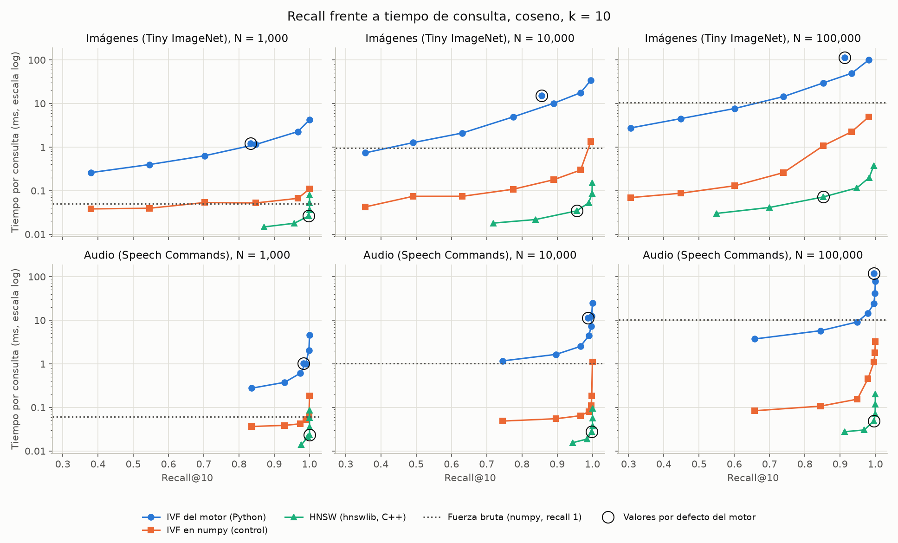
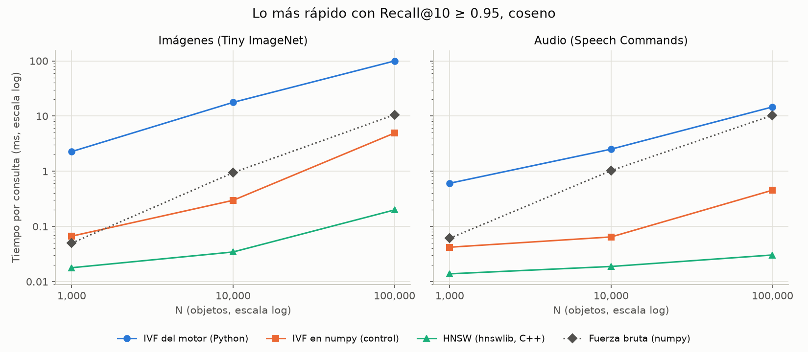
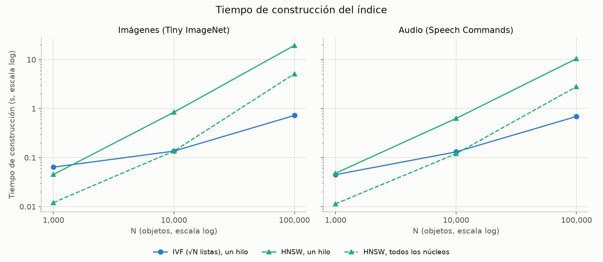
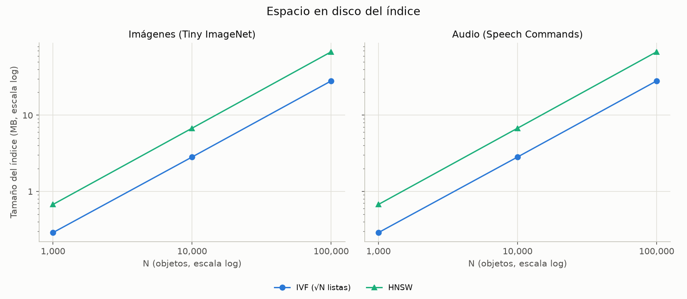
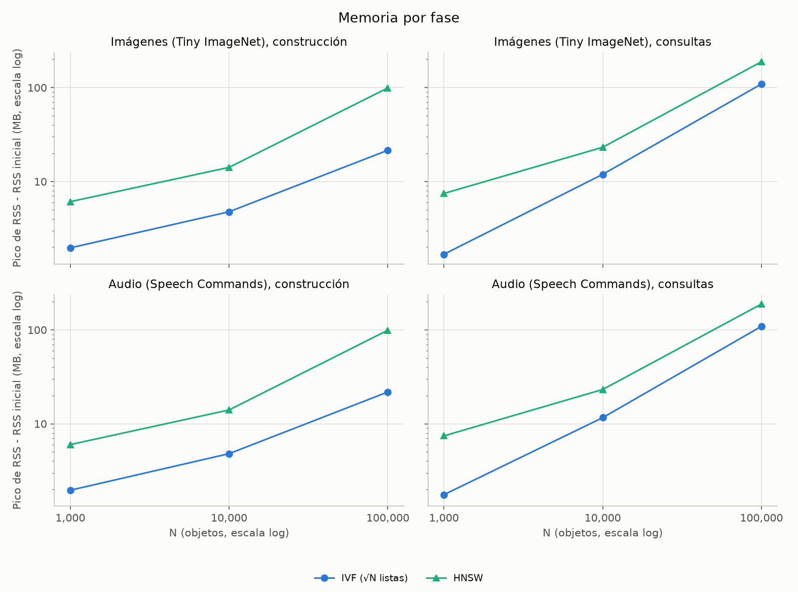
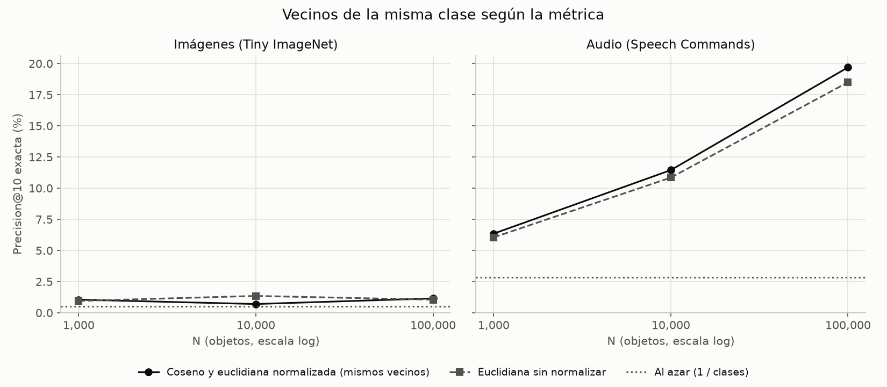
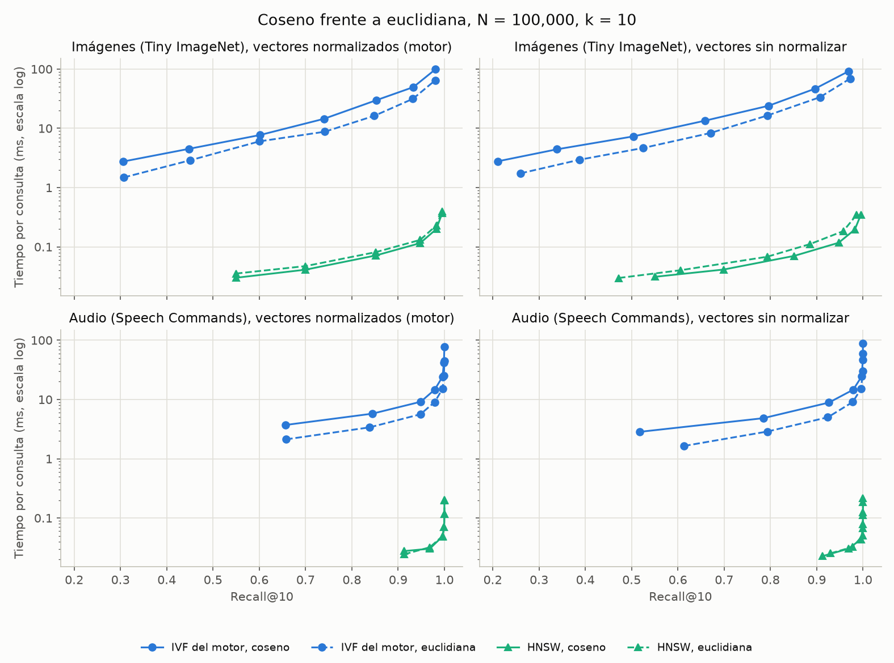

# Resumen: búsqueda por similitud con IVF y HNSW, coseno y euclidiana

Compara dos índices vectoriales sobre imágenes y audios, con dos métricas:

- **IVF:** implementación propia (`IVFIndex`). Agrupa con k-means y calcula las distancias en Python, candidato por candidato.
- **HNSW:** `HNSWIndex`, una capa sobre `hnswlib`, que está escrita en C++.
- **Referencias:** fuerza bruta con numpy, que también es la verdad exacta del recall, e IVF con las mismas listas pero con distancias en numpy (`ivf_numpy`). Este control indica cuánto de la diferencia se debe al lenguaje y no al algoritmo.

Instalación, comandos y metodología: [`benchmarks/README.md`](../README.md#comparación-de-similitud-ivf-vs-hnsw). Datos: [`vector_comparison_results.csv`](vector_comparison_results.csv). Entorno: [`vector_comparison_environment.json`](vector_comparison_environment.json).

## 1. Conclusiones

- **Velocidad:** con el mismo recall, HNSW es el más rápido en todos los tamaños. Con N = 100,000 y recall ≥ 0.95 tarda 0.20 ms en imágenes y 0.03 ms en audio. Es unas 500 veces más rápido que el IVF del motor, y entre 15 y 25 veces más rápido que el IVF en numpy, así que la ventaja no es solo del lenguaje.
- **Costo:** IVF es más barato. Con N = 100,000 se construye en 0.7 s frente a 10-20 s de HNSW con un hilo (3-5 s con todos los núcleos), ocupa 28 MB en disco frente a 68 MB y usa 109 MB en consultas frente a 189 MB.
- **Valores por defecto del motor:** el IVF por defecto (16 listas, sonda 4) es más lento que la fuerza bruta en todos los casos medidos: unas 11 veces con N = 100,000. El HNSW por defecto (`ef=50`) baja a recall 0.852 en imágenes con N = 100,000.
- **Métrica:** el motor normaliza sus vectores, así que coseno y euclidiana encuentran los mismos vecinos. Sin normalizar, las diferencias de precisión son pequeñas y no concluyentes.
- **Calidad de los vectores:** limita más que el índice. Incluso con búsqueda exacta, Precision@10 es 1.15% en imágenes y 19.7% en audio con N = 100,000.
- **Por SQL, hoy el índice casi no influye:** cada consulta vuelve a extraer y entrenar sobre todo el corpus. Con N = 1,000 tarda de 1.7 a 3.8 s, y más del 99% de ese tiempo es ese entrenamiento (sección 7).

## 2. Recomendaciones por escenario

Se refieren a los índices medidos directamente. Por SQL, el costo de la sección 7 domina hasta que se corrija.

| Escenario | Recomendación | Evidencia (N = 100,000 salvo que se indique) |
|---|---|---|
| Muchas consultas sobre una colección estable | **HNSW** | 0.03-0.20 ms con recall ≥ 0.95 |
| Imágenes u otros datos difíciles, recall alto | **HNSW con `ef=200`**, no el valor por defecto | Imágenes: recall 0.983 con `ef=200` frente a 0.852 con `ef=50`. Elegir `ef` midiendo con los datos propios: en audio, `ef=20` ya da 0.969 |
| Reconstrucción frecuente, o poca memoria y disco | **IVF con √N listas y distancias vectorizadas** | Construcción de 0.7 s, 2.4 veces menos disco. En numpy, recall 0.981 en 4.9 ms (imágenes) |
| Colección pequeña (N ≈ 1,000) o resultado exacto obligatorio | **Fuerza bruta vectorizada** | N = 1,000: 0.05-0.06 ms con recall 1, sin índice que construir. N = 100,000: 10.6 ms |
| IVF tal como está en el motor | **Evitarlo con los valores por defecto** | 113-121 ms frente a 10-11 ms de la fuerza bruta. Si se usa, ajustar a √N listas |
| Vectores normalizados (los del motor) | **Coseno** | Mismos vecinos que euclidiana. Los índices del catálogo se construyen en coseno y, si HNSW recibe otra métrica, revisa todos los vectores en Python |
| Vectores sin normalizar | **Coseno, salvo razón concreta** | Audio: 19.7% frente a 18.5% de precisión. Imágenes: recall de HNSW 0.983 frente a 0.958 con `ef=200` |

La fuerza bruta vectorizada y las distancias en numpy solo existen en este benchmark; el motor todavía no las ofrece.

## 3. Configuración

| Parámetro | Valor |
|---|---|
| Imágenes | Tiny ImageNet (64×64, 200 clases): SIFT. Se rechazaron 113 imágenes sin puntos clave y se reemplazaron |
| Audio | Speech Commands v2 (1 s, 35 clases): MFCC. Sin rechazos |
| Vectores | Histograma de 64 palabras con TF-IDF. Variantes: normalizada (norma L2, la del motor) y sin normalizar (conteos × IDF) |
| Codebook e IDF | Entrenados una vez con 5,000 objetos y reutilizados para todo N |
| N | 1,000 / 10,000 / 100,000 |
| Consultas | 200 fuera de la base, k = 10, 3 repeticiones por consulta |
| IVF | √N listas (32 / 100 / 316) con sonda de 1 a 64; motor: 16 listas, sonda 4 |
| HNSW | M = 16, `ef_construction` = 200, `ef` de 10 a 400; motor: `ef` = 50 |
| Hilos | 1 al medir, y además todos los núcleos en la construcción de HNSW |
| Entorno | Windows 11, 12 CPU lógicas, 15.7 GB de RAM, Python 3.12.2, numpy 2.5.3, scikit-learn 1.9.1, hnswlib 0.8.0 |

La preparación (extraer y cuantizar 100,000 objetos con 10 procesos) tardó 215 s en imágenes y 275 s en audio, más 14 s y 24 s de codebook.

`compare_vector_results.py` confirmó en las 536 filas el mismo k y número de consultas, y que IVF y su control devuelven lo mismo en los 184 pares. También confirmó que el recall de IVF no baja al sondear más listas, que las métricas equivalentes encuentran los mismos vecinos y que HNSW aprovecha los núcleos.

## 4. Recall frente a tiempo de consulta

Datos con vectores normalizados y coseno. El recall se mide contra la fuerza bruta de la misma métrica.

Configuración más rápida con Recall@10 ≥ 0.95:

| Modalidad | N | IVF del motor (ms) | IVF en numpy (ms) | HNSW (ms) | Fuerza bruta (ms) |
|---|---:|---:|---:|---:|---:|
| Imágenes | 1,000 | 2.272 (p=16) | 0.067 | 0.018 (`ef`=20) | 0.050 |
| Imágenes | 10,000 | 17.721 (p=32) | 0.297 | 0.034 (`ef`=50) | 0.943 |
| Imágenes | 100,000 | 99.575 (p=64) | 4.921 | 0.199 (`ef`=200) | 10.575 |
| Audio | 1,000 | 0.607 (p=4) | 0.042 | 0.014 (`ef`=10) | 0.061 |
| Audio | 10,000 | 2.514 (p=4) | 0.065 | 0.019 (`ef`=20) | 1.027 |
| Audio | 100,000 | 14.646 (p=8) | 0.454 | 0.030 (`ef`=20) | 10.310 |

Valores por defecto del motor:

| Modalidad | N | IVF: recall | IVF (ms) | HNSW: recall | HNSW (ms) |
|---|---:|---:|---:|---:|---:|
| Imágenes | 1,000 | 0.833 | 1.204 | 0.998 | 0.026 |
| Imágenes | 10,000 | 0.856 | 15.294 | 0.956 | 0.034 |
| Imágenes | 100,000 | 0.913 | 113.033 | 0.852 | 0.072 |
| Audio | 1,000 | 0.983 | 1.032 | 1.000 | 0.023 |
| Audio | 10,000 | 0.987 | 11.430 | 0.998 | 0.028 |
| Audio | 100,000 | 0.996 | 120.785 | 0.996 | 0.049 |

Con 16 listas y sonda 4 fijas, IVF revisa cerca de la cuarta parte de la colección en cada consulta (unos 27,000 vectores con N = 100,000), y en Python. Por eso su tiempo crece casi en proporción a N.

El efecto del lenguaje es grande pero variable: según N, la métrica y la sonda, el IVF del motor es entre 3 y 83 veces más lento que su control en numpy, con el mismo recall.

## 5. Construcción, espacio y memoria

1 MB = 1,048,576 B. Vectores normalizados y coseno. La memoria es el pico de RSS menos el RSS inicial de cada fase, y la de consulta incluye cargar el índice.

| Modalidad | N | Índice | Construcción, 1 hilo (s) | Todos los núcleos (s) | Disco (MB) | Memoria de construcción (MB) | Memoria de consulta (MB) |
|---|---:|---|---:|---:|---:|---:|---:|
| Imágenes | 1,000 | IVF (√N) | 0.064 | — | 0.3 | 2.0 | 1.7 |
| Imágenes | 1,000 | HNSW | 0.045 | 0.012 | 0.7 | 6.1 | 7.5 |
| Imágenes | 10,000 | IVF (√N) | 0.136 | — | 2.8 | 4.8 | 11.9 |
| Imágenes | 10,000 | HNSW | 0.844 | 0.136 | 6.8 | 14.2 | 23.2 |
| Imágenes | 100,000 | IVF (√N) | 0.724 | — | 28.2 | 21.5 | 109.3 |
| Imágenes | 100,000 | HNSW | 19.508 | 5.131 | 67.9 | 99.3 | 188.6 |
| Audio | 1,000 | IVF (√N) | 0.045 | — | 0.3 | 2.0 | 1.8 |
| Audio | 1,000 | HNSW | 0.048 | 0.011 | 0.7 | 6.0 | 7.4 |
| Audio | 10,000 | IVF (√N) | 0.131 | — | 2.8 | 4.8 | 11.6 |
| Audio | 10,000 | HNSW | 0.630 | 0.120 | 6.8 | 14.0 | 23.2 |
| Audio | 100,000 | IVF (√N) | 0.691 | — | 28.2 | 21.8 | 109.2 |
| Audio | 100,000 | HNSW | 10.465 | 2.814 | 67.9 | 99.2 | 188.7 |

Con todos los núcleos, HNSW construye entre 3.7 y 6.2 veces más rápido, y con N = 10,000 ya iguala a IVF con un hilo. La memoria de construcción favorece a IVF, porque reutiliza el arreglo de vectores que ya estaba cargado antes de medir; la de consulta es la comparación más justa.

## 6. Coseno frente a euclidiana

Precision@10 exacta: proporción de vecinos de la misma clase que la consulta, sin errores de índice.

| Modalidad | N | Coseno (ambas variantes) y euclidiana normalizada | Euclidiana sin normalizar | Al azar (1 / clases) |
|---|---:|---:|---:|---:|
| Imágenes | 1,000 | 1.05% | 0.95% | 0.5% |
| Imágenes | 10,000 | 0.70% | 1.35% | 0.5% |
| Imágenes | 100,000 | 1.15% | 1.05% | 0.5% |
| Audio | 1,000 | 6.35% | 6.05% | 2.9% |
| Audio | 10,000 | 11.45% | 10.85% | 2.9% |
| Audio | 100,000 | 19.70% | 18.50% | 2.9% |

- **Vectores normalizados:** con norma 1, ‖a−b‖² = 2 − 2·cos(a, b), así que las dos métricas ordenan igual. Los datos lo confirman.
- **Imágenes sin normalizar:** cada celda son unos 20 aciertos de 2,000 y el signo de la diferencia cambia según N. Es compatible con ruido, no con una ventaja de alguna métrica.
- **Audio sin normalizar:** coseno queda por encima en los tres tamaños, por 0.3 a 1.2 puntos. Las 200 consultas son las mismas en los tres tamaños, así que no son tres pruebas independientes: es un indicio, no una conclusión.

Tiempo con el mismo parámetro, N = 100,000:

| Implementación | Euclidiana frente a coseno |
|---|---|
| IVF del motor (Python) | 31-46% más rápida |
| IVF en numpy | 20-42% más lenta |
| Fuerza bruta en numpy | 47-63% más lenta |
| HNSW | Casi igual (de 6% más rápida a 15% más lenta) |

El signo cambia con la implementación, así que esto depende de cómo está programada cada distancia y no de la métrica en sí. El tiempo no debería decidir la métrica.

## 7. Costo por SQL

Las secciones anteriores miden el índice directamente. Por SQL, `VectorSearch` ejecuta `ExtractFeatures.fit` sobre toda la columna en cada consulta. Medido con `benchmark_vector_sql.py` en [`vector_sql_cost.json`](vector_sql_cost.json), N = 1,000 y 5 consultas por índice:

| Modalidad | Índice | Consulta por SQL (s) | Parte que es `fit` | Solo el índice (ms) |
|---|---|---:|---:|---:|
| Imágenes | IVF | 1.688 | 99.2% | 1.204 |
| Imágenes | HNSW | 1.959 | 99.4% | 0.026 |
| Audio | IVF | 3.573 | 99.2% | 1.032 |
| Audio | HNSW | 3.768 | 99.6% | 0.023 |

El script comprueba que el índice se haya usado en cada consulta. El costo es proporcional al corpus, así que **se estima** que con N = 100,000 cada consulta tardaría de 3 a 6 minutos; este valor no se midió. Mientras no se guarden el codebook y el IDF del índice para reutilizarlos, la elección de índice y de métrica no se notará por SQL.

## 8. Galería de aciertos y errores

`plot_vector_gallery.py` genera, por modalidad, las 3 mejores y las 3 peores consultas con sus 10 vecinos exactos, marcados según su clase. El audio se muestra como espectrograma. Las figuras contienen imágenes de los datasets, así que se quedan en local (`results/gallery/`) y no se versionan. Tarda unos 10 s con el corpus descargado.

Con N = 100,000, la mejor consulta de imágenes solo acierta 3 de 10 y la de audio acierta 10 de 10. Son casos extremos, no una muestra representativa.

## 9. Limitaciones

- **Python frente a C++:** IVF y HNSW no se comparan en igualdad de implementación. Por eso existe el control en numpy, que sí es comparable en algoritmo, pero no es código del motor.
- **Vectores:** codebook e IDF se entrenaron una vez con 5,000 objetos, mientras que el motor los entrena con todo el corpus. La variante sin normalizar solo existe en el benchmark.
- **Métrica por SQL:** el catálogo crea los índices siempre en coseno y con parámetros por defecto, así que varias configuraciones medidas no se pueden pedir por SQL todavía.
- **Etiquetas:** la clase es solo una aproximación a la similitud. Dos imágenes de clases distintas pueden parecerse, y en audio una consulta y un vecino pueden ser del mismo hablante, porque la partición es al azar.
- **Construcción:** cada índice se construyó una sola vez, así que esos tiempos no tienen repeticiones.
- **Memoria de HNSW:** incluye el margen que reserva el índice (`max_elements` = 2N) y el diccionario de vectores que guarda en Python.
- **Control en numpy:** su tiempo salta más de lo esperado entre `n_probe` 8 y 16 en imágenes (de 0.26 a 1.08 ms, con el doble de candidatos). No se investigó la causa, y afecta a las proporciones Python/numpy citadas.
- **Máquina:** una sola máquina con Windows. Las proporciones son más transferibles que los tiempos absolutos.
